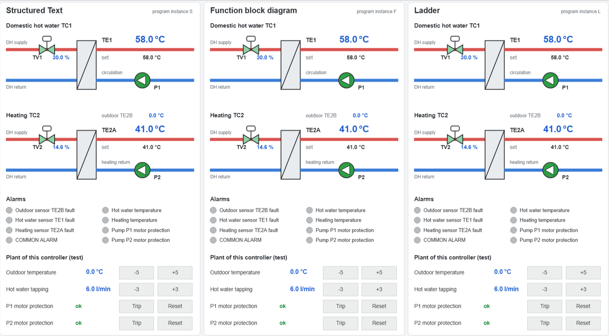
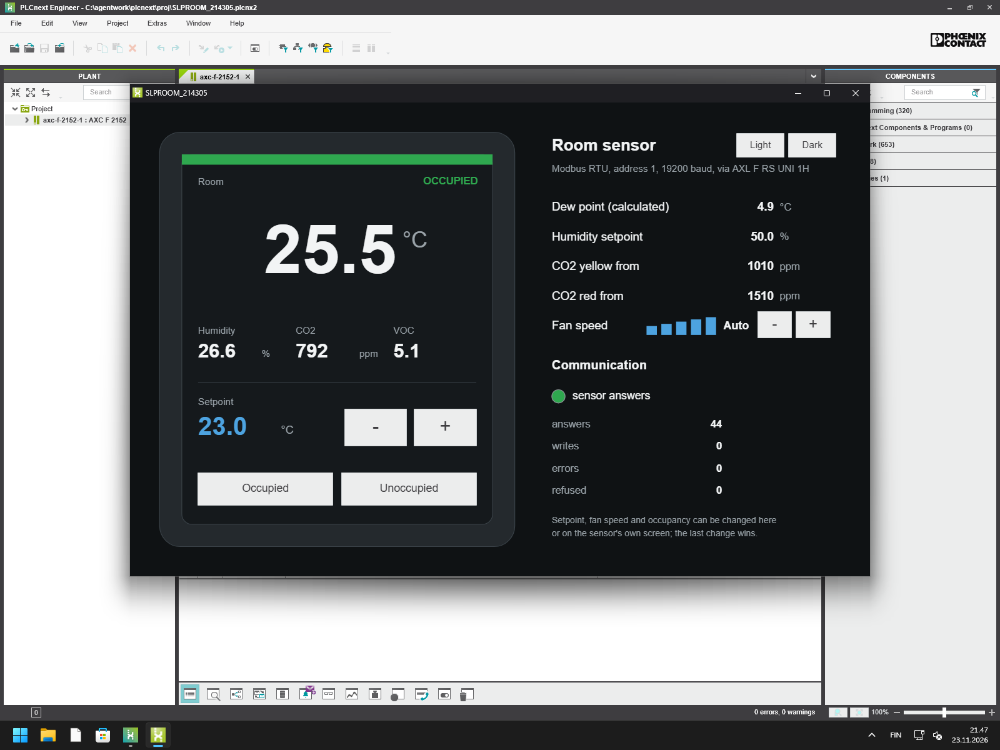
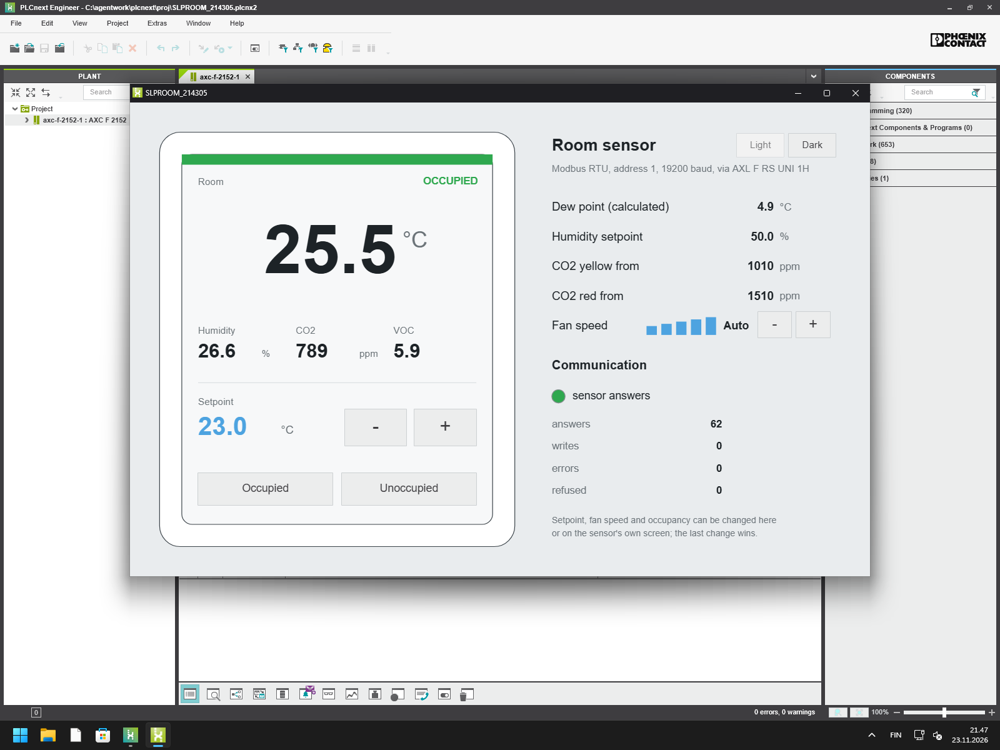
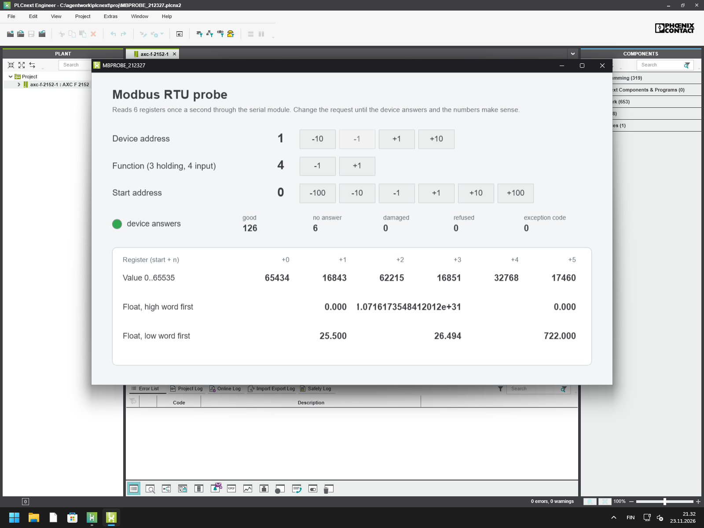
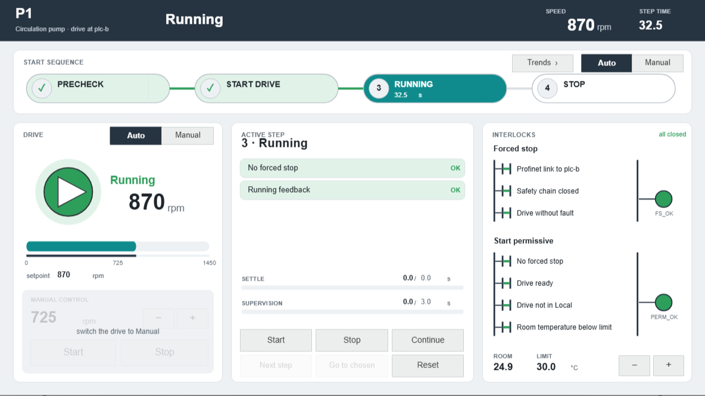
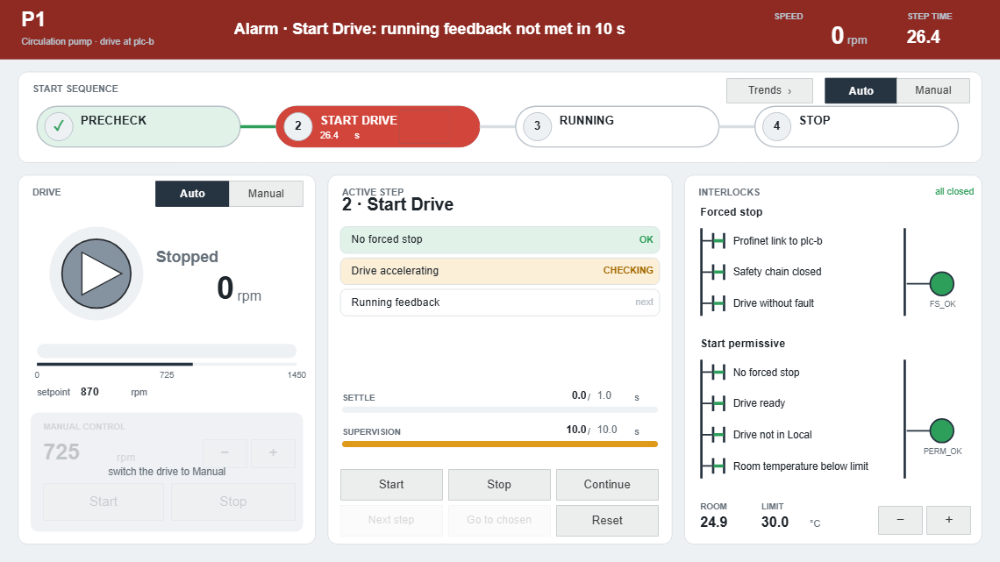
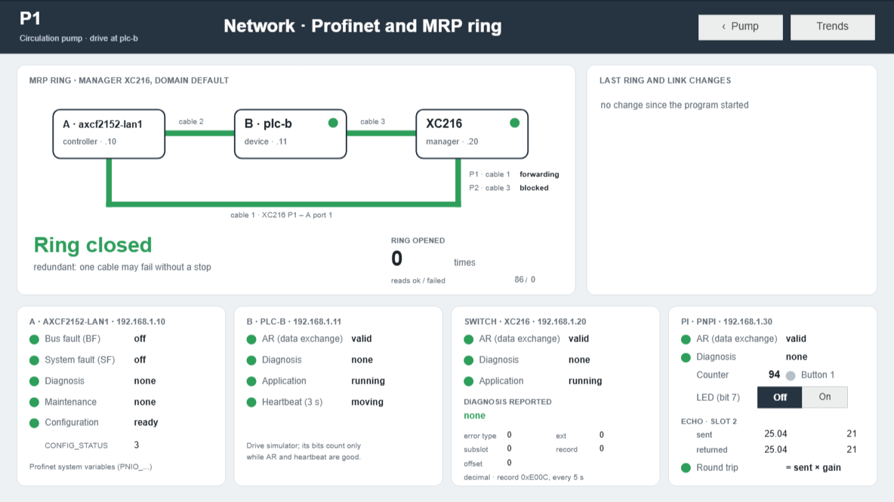

# plcnext-engineer: a Claude skill for Phoenix Contact PLCnext Engineer

Lets an AI coding agent (Claude Code) program a PLCnext controller for you: you describe the plant, the agent
writes the control program, generates the PLCnext Engineer project, opens and compiles it in the real tool,
writes it to the controller, builds an operator page (eHMI) with live values and checks the result on the
running controller.

PLCnext Engineer has no scripting interface. The skill writes the project file itself (it is a zip with the code
as plain text) and works the real tool through its user interface for what only the tool can do: compile,
connect, write and start. That is undocumented behaviour of one tool version (2026.6) and may break on another.

What it does:

- **Structured Text** (IEC 61131-3) as plain files, and **ladder / function block diagram** sheets described in
  a few lines of Python, laid out and wired by the generator.
- **Operator pages** served by the controller: values, lamps, bars, buttons, pump and valve symbols, a light and
  a dark look, trend charts over the controller's DataLogger, page switching.
- **Step sequences** in Structured Text (SFC needs a separate licence): requirements checked one by one, settle
  and supervision times, held alarms, manual overrides below the safety interlocks, shown on the page.
- **Values into ClickHouse** over HTTP from Structured Text (batched, time stamped by the server), read back for
  display, and a Grafana dashboard.
- **I/O modules and Modbus RTU** through an Axioline serial module (AXL F RS UNI 1H): a probe for an unknown
  device, and a complete room sensor with reads and writes.
- **Modbus TCP** with the firmware's own client: registers, floats, connection state.
- **OPC UA between two controllers**: one serves, the other's firmware client reads and writes.
- **Profinet between two controllers**: one is the Profinet controller, the other a Profinet device; up to 512
  bytes each way, in real time.
- **Profinet MRP ring** with a managed switch as ring manager: ring state, device diagnosis and the switch's own
  diagnosis on a page. The switch side (CLI, backups, MRP state, Profinet naming) is a separate skill:
  [scalance-xc200-skill](https://github.com/Maxxis20/scalance-xc200-skill).
- **MQTT out** with the firmware's own client (and a FUXA view of the values), and **MQTT in** with a small
  MQTT client in Structured Text (ChirpStack uplinks, for example).
- **Backup and restore** of a controller's project, checked by checksum against the controller.
- **No controller needed** to start: the free AXC F 1152 simulation of PLCnext Engineer works too.

What is in the skill:

- `SKILL.md`: what the agent reads first.
- `reference/findings.md`: the project file format, how the tool behaves when driven from outside, facts about
  the controller; each marked proven, seen or untested. Beside it `modbus-rtu.md`, `modbus-tcp.md`, `opcua.md`,
  `profinet.md`, `mqtt-subscribe.md`, `hmi-trends.md`, `hmi-design.md`, `sequence-st.md`, `clickhouse.md`.
- `scripts/pxe.sh`: the driver. Build, open, read errors, write to the controller, state, values, operator page,
  screenshots.
- `scripts/pxproj.py`, `scripts/pxld.py`, `scripts/pxhmi.py`: project, ladder / function block diagram and
  operator page generators.
- `scripts/vm.sh`, `scripts/config.sh`, `scripts/win/`: how the scripts reach the machine that runs Engineer, and
  their settings.
- `scripts/plc-backup.sh`: backup, check and restore of a controller's project.
- `scripts/plc-ssh.sh`, `scripts/plc-mqtt.sh`, `scripts/plc-opcua-client.sh`, `scripts/pxe-login.sh`,
  `scripts/pxfuxa.py`: a shell on the controller, its MQTT client, OPC UA client connections, Engineer's login
  dialog, a FUXA view.
- `examples/`: worked examples (below).

The district heating example built three times by the agent in one run (27 min 46 s): Structured Text, function
block diagram and ladder, each with its own plant model, side by side on one operator page served by the controller.
The example folder holds the Structured Text version.



Modbus RTU through the serial module: the room sensor example's page, shaped like the sensor (dark and light look),
and the probe that finds address, register base and word order of an unknown device.

<p>


</p>



A pump start sequence over Profinet: the step flow, the drive, the active step's checklist with its settle and
supervision times, and the interlocks as a ladder; running, and held by an alarm.





A Profinet MRP ring of two controllers and a managed switch as ring manager: the ring state read from the ports,
each device's connection and diagnosis, and the switch's own diagnosis as text (the switch itself is driven by the
[scalance-xc200-skill](https://github.com/Maxxis20/scalance-xc200-skill)).



## What you need

- A Windows machine with PLCnext Engineer 2026.6 and its licence.
- When the agent runs on that Windows machine: Git for Windows (Git Bash, which Claude Code uses there) and
  Python 3 on it.
- A PLCnext controller on the network (worked out on AXC F 2152, firmware 2025.6.0 and 2026.0.2), or the free
  AXC F 1152 simulation of PLCnext Engineer (separate installer, `reference/findings.md`, "Simulation"). A bench
  controller, never one that runs a plant: the agent writes and starts programs.
- For MQTT out only: Mosquitto on the Engineer machine, reachable from the controller on port 1883, and FUXA
  (`npm install @frangoteam/fuxa`) on `http://127.0.0.1:1881/`; `scripts/win/mqtt-flatten.js` running beside them.

## Where it runs

The scripts are bash and Python; what has to happen on the Engineer machine they send there as PowerShell
(`scripts/vm.sh`). Two transports:

- **local** (the default when the scripts run in Git Bash on Windows): the agent runs on the Windows machine that
  runs Engineer, as the Ouman and Schneider skills do. PowerShell is started directly. Proven on Windows 11 with Git for Windows 2.47 and Python 3.12: the whole loop below, driven from a bash on that machine; not yet by an agent working there day to day.
- **proxmox**: the agent runs on another machine (Mac or Linux) and the Engineer machine is a Windows VM on a
  Proxmox host, reached through the qemu guest agent: root ssh by key to the host, the guest agent running in the
  VM, a user logged on at its screen. No password, no remote desktop. This is how the skill was worked out.

Settings come from the environment or from the file `~/.plcnext-engineer/config` (plain `NAME=value` lines;
the folder also holds the base projects). All of them are described in `scripts/config.sh`:

```bash
PLC_HOST=192.168.1.10          # the controller (default: the factory address)
PLC_SECRET=PLC_PASSWORD        # name of the environment variable with the controller's admin password
#PLC_SECRET_RUN="op run --"    # optional: your secret manager's runner in front of the one process that reads it
# proxmox transport only:
#PXE_TRANSPORT=proxmox
#PLCVM_NODE=node1              # Proxmox node name
#PLCVM_NODE_IP=192.168.1.5     # its address (root ssh by key)
#PLCVM_ID=100                  # the VM's id
#PLCVM_USER=engineer           # the Windows user logged on at the screen
```

`scripts/pxe.sh check` says what is missing: the Engineer machine, Engineer running, the controller answering,
the base projects.

**Password.** The default way: the first Connect opens Engineer's login dialog on that machine; type the
controller's user and password there and tick "Remember credentials". After that the agent only presses OK. Do
not paste the password into the chat. Only the shell on the controller (`plc-ssh.sh`, used for backups, the MQTT
and OPC UA settings) and `pxe-login.sh` need the password themselves: they read it from the environment variable
named in `PLC_SECRET`, through `PLC_SECRET_RUN` if you set one, and pass it on through stdin, never printed,
never in a command line, never on disk.

**Base project.** The generator builds on an empty project that the tool made for your controller type and
firmware. It is Phoenix Contact's data and is not in this repository; `reference/findings.md` ("Base project")
says how to make one in a minute.

## By hand, if you want to see it work first

```bash
P=scripts/pxe.sh
$P check                                   # Engineer machine, Engineer, controller, base projects
$P start                                   # start Engineer (2.5 minutes)
$P build examples/dh-ex2                   # sources -> examples/dh-ex2/DH_EX2.plcnx2
$P open examples/dh-ex2/DH_EX2.plcnx2      # "0 errors, 0 warnings"
$P write                                   # connect, Write and Start
$P read DH.TE1 DH.TV1                      # live values from the controller
$P hmi page.png                            # the operator page in a browser, screenshot
```

**Hands off the keyboard and mouse of the Engineer machine while a command runs.**

## Examples

| Folder | What | State |
|---|---|---|
| `examples/dh-ex2` | district heating substation (Finnish Energy K1/2013, example connection 2): controller, plant model, operator page, values out over MQTT into FUXA | ran on an AXC F 2152 and on the simulation |
| `examples/ld-demo` | ladder and function block diagram on one sheet: timers, a project block, set / reset coils | ran on an AXC F 2152 |
| `examples/rs-uni-modbus` | Modbus RTU probe through the serial module: address, function and register base chosen on a page | ran on an AXC F 2152 |
| `examples/modbus-rtu-room-sensor` | a Modbus RTU room sensor with reads, writes and a page shaped like the sensor, light and dark | ran on an AXC F 2152 |
| `examples/modbus-tcp-read` | a float and a scaled value from a Modbus TCP server, connection lamp and counters | built; the same pattern ran |
| `examples/opcua-pair` | two controllers: A serves, B's firmware client reads and writes, a counter shows the link | built; the same pattern ran |
| `examples/profinet-pair` | two controllers over Profinet: B (device) passes Modbus TCP values to A, A's counter comes back as an echo | device side built; the same pattern ran |
| `examples/mqtt-subscribe` | values from an MQTT broker into the program (ChirpStack uplinks) | built; the blocks ran 8 hours |
| `examples/pump-sequence` | pump start sequence in ST on A, drive and safety chain simulated on B over Profinet; interlocks, four pages, trends, ClickHouse; a REST test script | ran on two AXC F 2152, 41 of 41 checks |
| `examples/profinet-mrp-ring` | MRP ring of A, B and a managed switch as manager; Network page with ring state (RDREC 0x802A), per-device AR and diagnosis, the switch's diagnosis (0xE00C) as text, a latched ring warning; a Raspberry Pi p-net device from its GSDML | ran on two AXC F 2152 and the switch; ring tests with pulled cables |
| `examples/clickhouse-log` | the ClickHouse client blocks on their own, the table, a Grafana dashboard | built; the blocks ran in pump-sequence |

## Limits

- Structured Text, ladder and function block diagram (LD/FBD sheets, layout and wires generated). No SFC (it
  needs a separate licence; sequences are written in ST).
- I/O modules: ports and their links are generated; the module itself is added once in Engineer and kept in a
  base project. Tried with one module type (serial, Modbus RTU).
- Operator page: texts, values, lamps, bars, buttons, pump and valve symbols, trend charts. No alarm table.
- ClickHouse: plain HTTP only (no TLS); the password is built into the project file.
- Modbus TCP: reading registers only, one server per base project.
- OPC UA client: without the vendor's client licence it runs 4 hours from the start of the controller's runtime.
- Profinet: the device entry on the controller side is made once by hand (base project), and the device's name
  on the network is assigned once by hand in Engineer. One device tried.
- MQTT: the firmware client publishes only; the Structured Text client takes plain TCP, no login, one topic, QoS 0.

## Not affiliated

An independent project, not made, endorsed or supported by Phoenix Contact. PLCnext and PLCnext Engineer
are trademarks of Phoenix Contact GmbH & Co. KG. No Phoenix Contact software or files are included; you need your
own licensed installation of PLCnext Engineer.

MIT licence.
