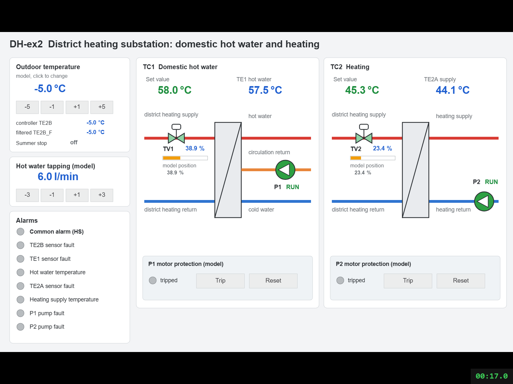
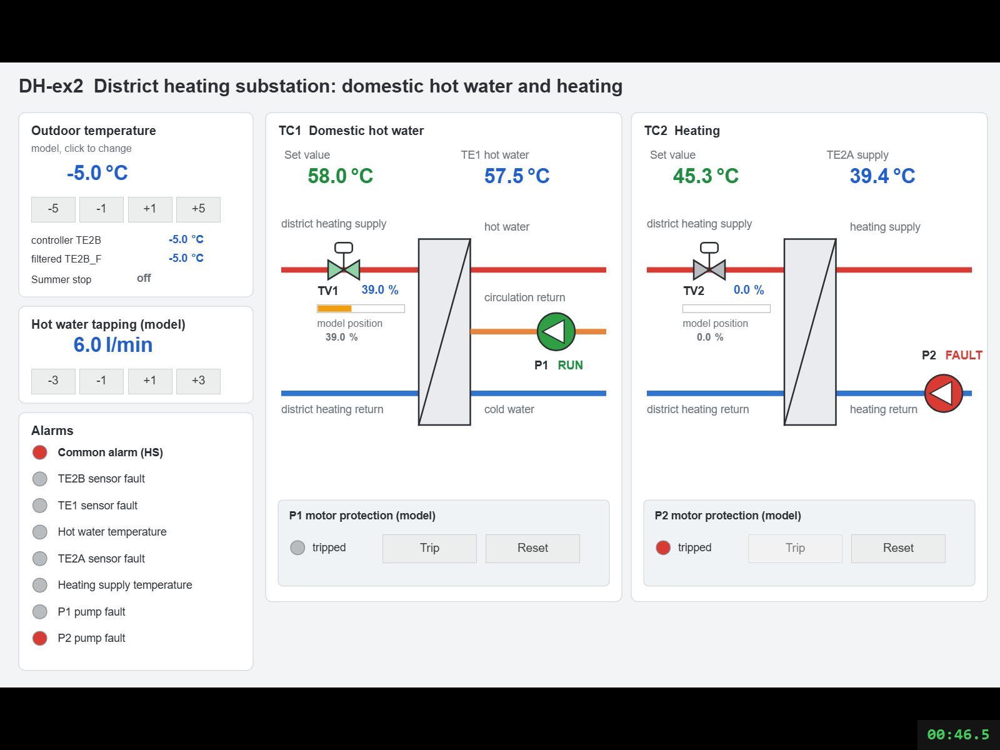
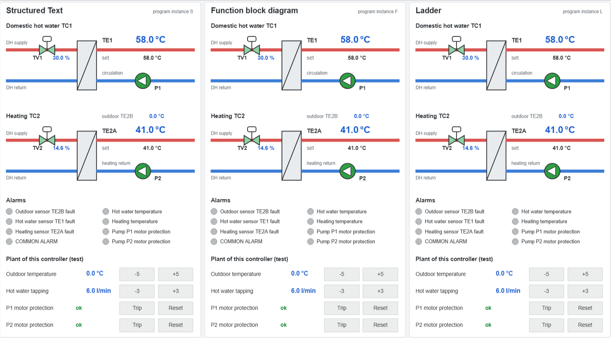
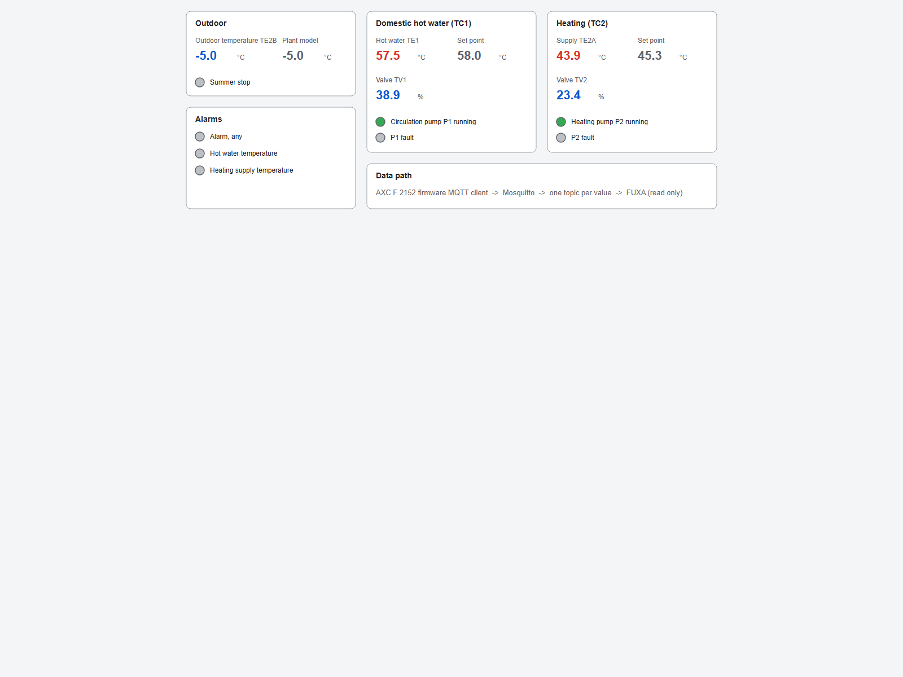

# DH-ex2 on PLCnext: district heating substation

Same example as the Ouman (`ouflex-ba-tool-skill/examples/dh-ex2`) and Schneider
(`ebo-workstation-skill/examples/dh-ex2`) versions: domestic hot water and heating, one control valve and one
pump each, after example connection 2 of Finnish Energy publication K1/2013. Target: AXC F 2152, firmware 2026.0.

`DESCRIPTION.md` is the description of operation as written for the Ouman version, unchanged. Differences here:
pump faults as in the Schneider version (P1 fault alarms only; P2 fault alarms and closes TV2), and no fixed I/O
or Modbus map yet.

| File | What |
|---|---|
| `src/FB_LAG1`, `FB_DELAY`, `FB_PI` | first-order filter, on-delay in seconds, PI controller (gain = 100 / proportional band, anti wind-up, dead band) |
| `src/FB_OUTDOOR`, `FB_TC1_DHW`, `FB_TC2_HEAT` | the three control modules of the description |
| `src/FB_DH_PLANT` | plant model (same formulas as the Schneider `DH-ex2-SIM`) |
| `src/DH_EX2` | the program: set values, measurements, plant model while `SIM` = TRUE, common alarm |
| `program.json` | POU list, task `Cyclic100` (100 ms) with instance `DH`, connection target |

Build the project file and load it:

```bash
P=../../scripts/pxe.sh
$P build . && $P open DH_EX2.plcnx2 && $P write   # -> DH_EX2.plcnx2, 0 errors, written and running
$P read DH.TE1 DH.TV1 && $P hmi page.png
```

## Operator page

`hmi.py` describes the page; `pxproj.py` writes it into the project as eHMI page `Home` (start page). Pump and control
valve are drawn by `pxhmi.py`: centred on their pipes, pump green when running and red when stopped or tripped,
valve coloured by its position. Served by the controller at
`https://192.168.1.10/ehmi/hmiapp.html`. `program.json` switches the HMI login off and the REST interface on
(`hmi_server`): fine on the bench, not for a plant.




The same task in three languages (a later run: the agent wrote the controller in Structured Text, function block
diagram and ladder, each with its own plant, and ran the trip, tapping and outdoor tests on all three; the settled
values agreed within 0.01). Only the Structured Text version is in this folder.



## Checked and not checked

Checked on 2026-11-22: Engineer 2026.6, real AXC F 2152 with firmware 2025.6.0, no I/O modules, `SIM` = TRUE.

- The generated project opens with 0 errors and 0 warnings and is written to the controller; RUN.
- Normal state, outdoor -5 degC, tapping 6 l/min: TE1 57.5 at set value 58.0 with TV1 39 %; TE2A 44.75 at curve
  set value 45.25 with TV2 23 %; both pumps on, no alarm. Both loops rest at the edge of the 0.5 degC dead band.
- Operator page in a browser shows live values; its buttons write to the controller.
- P2 trip from the page: P2 stops, P2 fault and common alarm on, TV2 goes to 0 %, TE2A falls. Reset: recovers.
- P1 trip: P1 stops, P1 fault and common alarm on, TV1 keeps controlling (39 %, TE1 57.5).
- Outdoor step -5 to -15 degC: measured value follows at once, filtered value moves slowly (900 s filter), heating
  set value starts to rise.

Not checked: sensor faults, temperature limit alarms, summer stop, the end state after a long outdoor step.
`TS` (0.1 s) must match the task interval by hand. Three-point curve holds its end values outside
-20...+20 degC outdoor (a choice; the description leaves it open). The last label fixes in `hmi.py` are built but
not yet written to the controller.

## Over MQTT, into FUXA

Sixteen of the program's variables are also flagged `{ OutputPort, PROFICLOUD }` (`src/DH_EX2/Variables.var`). With
the controller's MQTT client pointed at a broker (`scripts/plc-mqtt.sh 192.168.1.251 plcnext/dh axcf2152-dh`) they
go out once a second; `fuxa_view.py` makes a FUXA view of them and `pxe.sh fuxa DH-ex2.fuxa.json` shows it.
Read only: the firmware client cannot subscribe.


