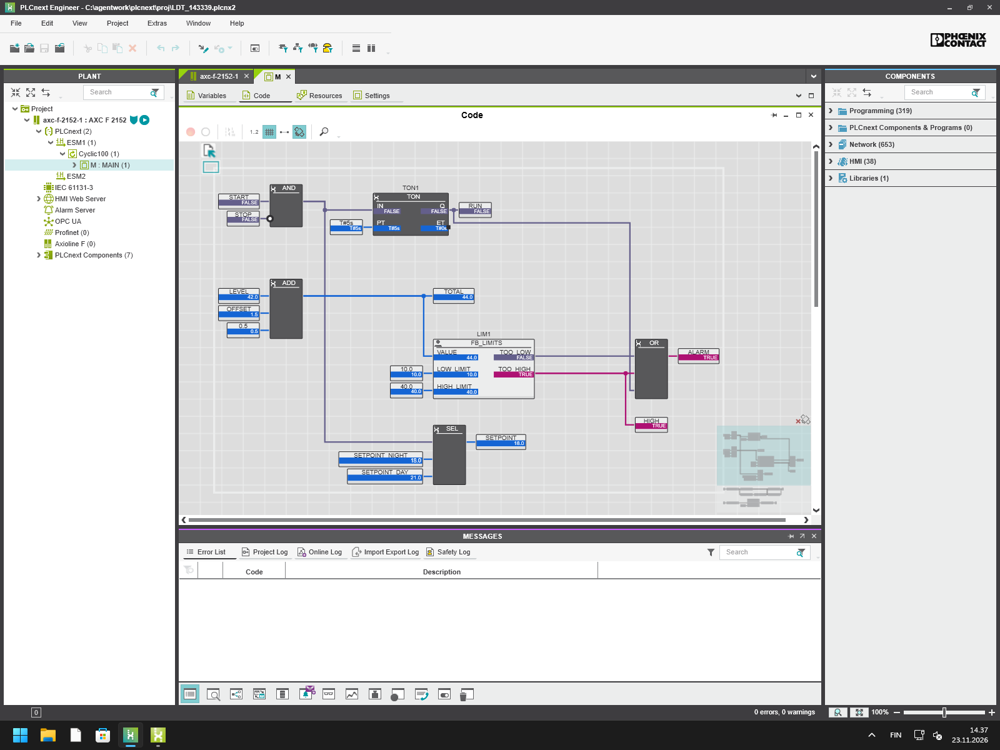

# ld-demo: ladder and function block diagram

`src/MAIN/Code.ld.py` describes one sheet: two function block networks (a start delay; a sum, a limit check with
the project's own `FB_LIMITS`, a selector) and two ladder rungs (parallel branch, set and reset coils, a timer in
the rung). `pxld.py` places and wires it. Proven on an AXC F 2152: 0 errors, live values as in the picture.



```bash
P=../../scripts/pxe.sh
$P build . && $P open LDT.plcnx2 && $P write && $P show M
```
