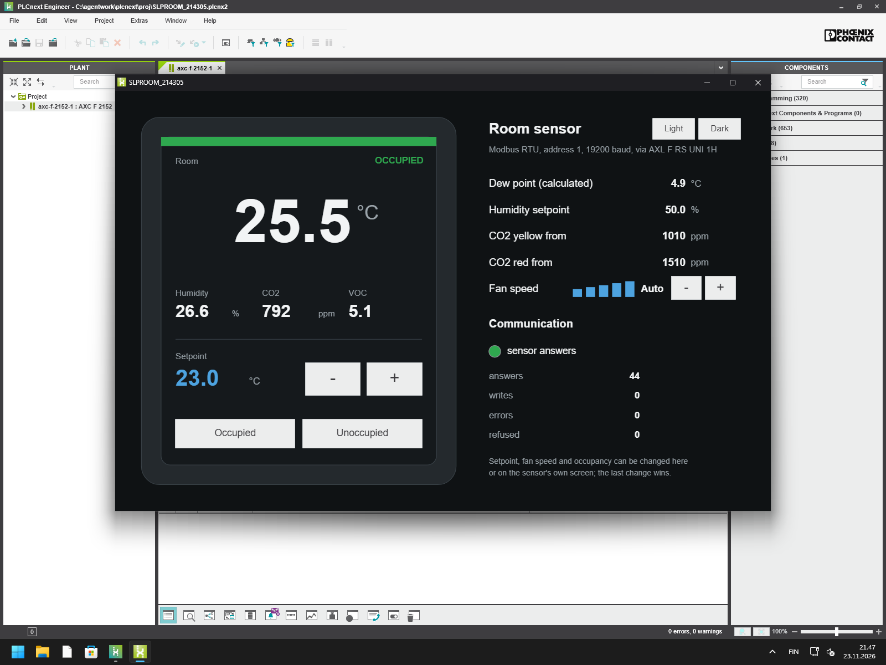
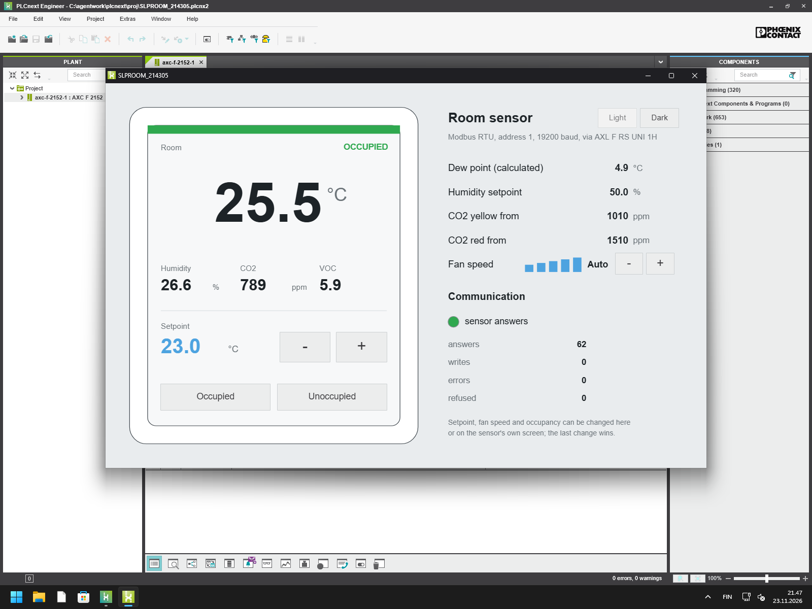

# modbus-rtu-room-sensor: a Modbus RTU room sensor with an operator page shaped like the sensor

AXC F 2152 (firmware 2026.0) + AXL F RS UNI 1H + a Modbus RTU room sensor (address 1, 19200 baud, no
parity). Proven on the controller: all values read once a second without errors; temperature setpoint and fan
speed written from the page and taken by the sensor.

Light and dark look, switched by two buttons on the page (`M.DARK`): areas change their fill with the variable,
every text exists once per look and is shown by it (a text's colour cannot follow a variable).

- `src/MAIN/Code.st`: one request at a time through the serial module: six polling requests in turn (FC 04, 03,
  01), a pending write first (FC 16 setpoint and fan speed, FC 05 occupancy). A value changed on the sensor's own
  screen comes in with the next poll; a value changed on the page is sent once; the last change wins.
- `src/FB_IEEE`, `src/FB_TOIEEE`: float bit pattern to REAL and back.
- `hmi.py`: the page. Buttons change whole numbers (`SP_REQ10` = setpoint x 10), the program does the rest.
- `program.json`: `io` links the program's ports to the module's process data.

Found on this sensor (firmware as delivered): wire address = printed number - 1; floats low word first; fan speed
is a whole number, high word first, 1 = Off, 2 = Low, 3 = Med, 4 = High, 5 = Auto; the printed dew point
registers (54-55) only repeat humidity and CO2, so the dew point is calculated (Magnus formula); the occupancy
coil (6) takes a write without complaint but reads back off: not understood.

Simpler version with one request only: `../rs-uni-modbus`.
