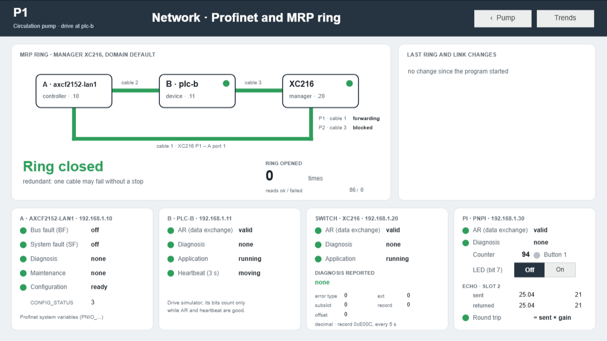
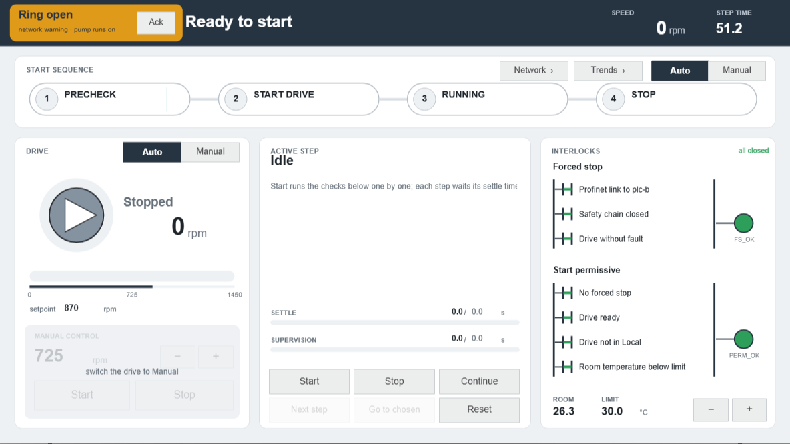
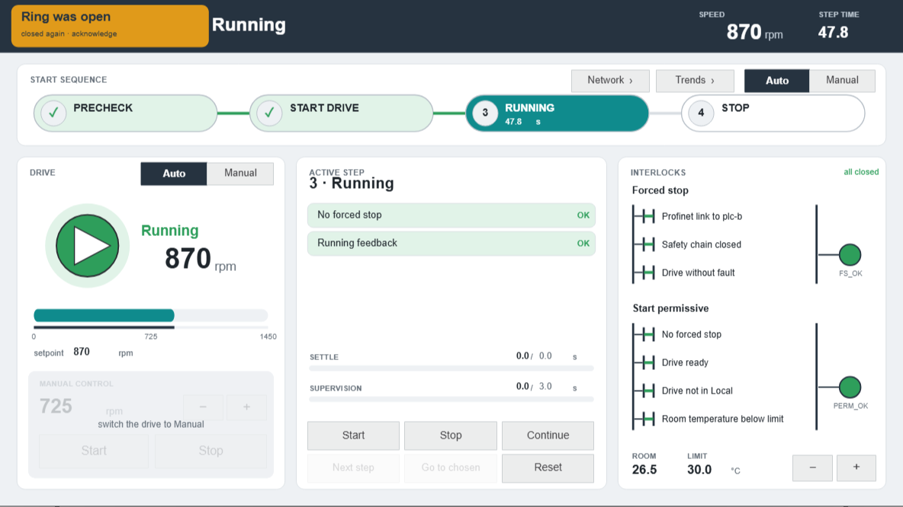
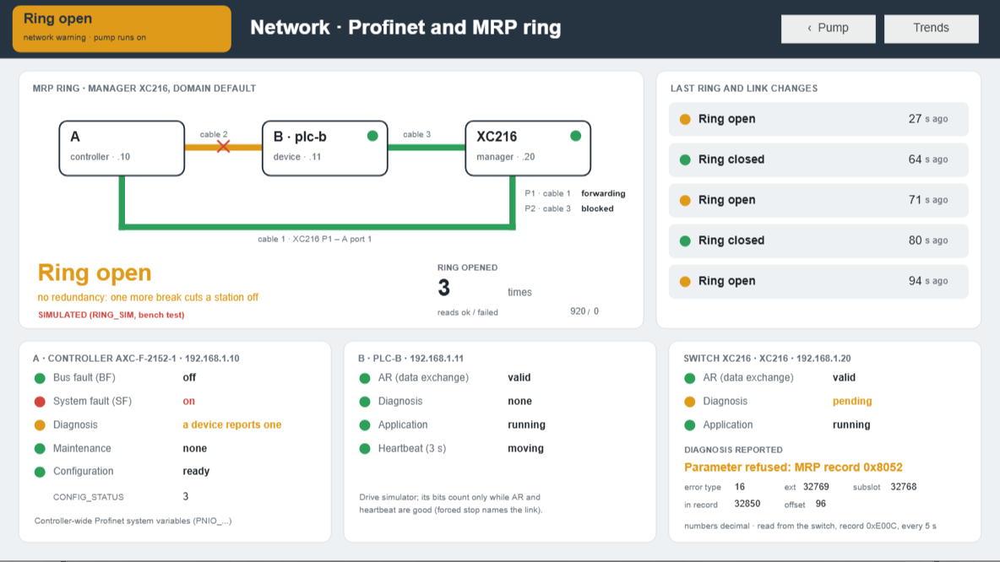
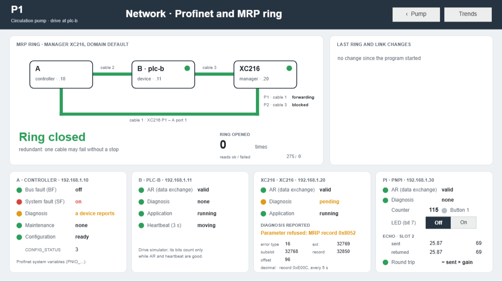

# profinet-mrp-ring: a Profinet MRP ring with diagnosis pages on the controller

Controller A, controller B (a Profinet device) and a SCALANCE XC216 managed switch in one MRP ring: the switch is
the MRP manager, A and B are clients. A runs the pump sequence of `../pump-sequence` and adds a page "Network"
that shows the ring and the Profinet state of every device, read by the program itself (the switch's CLI side,
its MRP state and naming: [scalance-xc200-skill](https://github.com/Maxxis20/scalance-xc200-skill)):

- the ring A - B - switch with its three cables, "Ring closed / open / unknown", how often it opened, the
  manager's two ring ports (forwarding / blocked / no link) and the last five ring and link changes;
- **ring state from record 0x802A** (PDPortDataReal) of the manager's two ring ports, read with `RDREC`: the
  manager blocks one ring port while the ring is closed and forwards on both when it is open;
- **one card per station**: A's controller-wide system variables (`PNIO_SYSTEM_BF`, `_SF`, `_DIAG_AVAILABLE`,
  maintenance, configuration), and for each device its AR, diagnosis and application state from the items of
  its DAP (`plc-b/PN_AR_VALID`, ...); B's heartbeat;
- **the switch's diagnosis** read as record 0xE00C through its DAP and decoded to text (channel error type,
  extended type, subslot, and for a refused parameter the record and offset);
- a **latched ring warning** on the Pump page: amber "Ring open · pump runs on", "Ring was open · closed again"
  until **Ack**; the pump is not stopped by an open ring;
- a **third-party device** from its GSDML: a Raspberry Pi running the rt-labs p-net sample app (station `pnpi`,
  8 bits in and out, an echo module with a float and an integer each way), on a non-ring port of the switch.

**Proven** on 2026-11-24 on two AXC F 2152 (firmware 2026.0.2), the switch (firmware V4.4) and PLCnext Engineer
2026.6: the ring tests with pulled cables, the Network page with the ring closed, the switch's diagnosis
(a parameter fault, then none after the fix), the ring warning with the test input `RING_SIM`, the p-net device's
values both ways. Details and what was not tried are below; background in `../../reference/profinet.md`,
sections "MRP ring redundancy" and "Diagnosis on the controller".

## Files

- `a/`: project PUMPPI on A (192.168.1.10). `MAIN` is the program of `../pump-sequence/a` plus the device
  states, the ring state, the switch's diagnosis, the event list, the ring warning and the p-net device (all in
  the second half of `Variables.var` and `Code.st`). `FB_CH`, `FB_TXT` (ClickHouse client), `FB_IEEE`,
  `FB_TOIEEE` as there. Pages in `hmi.py`: Pump, Trends, History, Room, Network. `program.json` links the
  serial module, B's IO 512 module, the DAP items of the three devices and the p-net device's typed items through
  `io`, with the device's station name in front (`"pnpi/Output float from controller"`).
- `img/`: the pictures in this file.
- B runs `../pump-sequence/b` unchanged: its MRP role is set in A's project, not in B's.

## Before the first write

1. **Base project for A, by hand in Engineer** (not included: it holds the switch's whole GSDML, vendor data):
   start from the base of `../pump-sequence` (serial module and B as device), import the switch's GSDML, add
   the switch as device `xc216` with role Manager, ring ports 1 and 2, its update time and monitor factor, and
   **MRP 2..4 in domain UUIDs of their own**; for the p-net device import its GSDML and add it as `pnpi` with
   the modules "DIO 8xLogicLevel" and "Echo Module" (gain parameter 1). How, step by step:
   `../../reference/profinet.md`, "MRP ring redundancy" and "A third-party device from its GSDML". Strip it to
   `AXCF2152-2026.0-RSUNI-PNB-MRP-PI` (or change `base` in `a/program.json`).
2. **Node IDs**: the program reads records of the switch by the Node IDs Engineer gave its submodules in that base
   (DAP 29, port 1 31, port 2 32: `XD(... ID := DWORD#29 ...)`, `ID := TO_DWORD(30 + RR_PORT)` in `Code.st`).
   Look them up in your base (`PN:NodeID` in the `.ds` of each submodule) and change them if they differ.
3. **The database password**, as in `../pump-sequence`: `a/src/MAIN/Code.st` has
   `KEY := '%%ENV:CLICKHOUSE_PASSWORD%%'` and `HOST := '192.168.1.60'`; build through your secret manager's
   runner, e.g. `op run -- scripts/pxe.sh build examples/profinet-mrp-ring/a`. Without a database set any value
   and `CH_ON := FALSE`. The built `.plcnx2` then holds the password: do not share it.
4. **Names on the network**: B, the switch and the p-net device by Online Devices, once each. The switch may
   refuse it until its DCP server is set writable on its CLI (`../../reference/profinet.md`, "Naming the switch";
   the CLI steps are in the [scalance-xc200-skill](https://github.com/Maxxis20/scalance-xc200-skill)).
5. **Cabling: a line first, the ring last.** Switch port 1 - A port 1, A port 2 - B port 1, write B and A, check
   that the switch is MRP manager, then B port 2 - switch port 2. The p-net device and the Engineer machine go on
   other ports of the switch.

## What was proven

| What | Result |
|---|---|
| One ring cable pulled (A - B, then switch - A), pump running at 870 rpm | pump kept running, no alarm, no AR lost on A or B; ring closed again when plugged back (**proven**) |
| Both of B's cables pulled | forced stop within one sample, B's drive stopped (**proven**) |
| B's runtime restarted while running | forced stop named "Profinet link to plc-b lost" (from `PN_AR_VALID`), B's interlock rows "unknown", link events, Reset to idle (**proven**, 11 checks) |
| Ring state from 0x802A, ring closed | port 1 forwarding, port 2 blocked, "Ring closed", no failed read in hundreds of reads (**proven**) |
| Ring warning with `RING_SIM` (pump running) | warning, pump runs on, latch after closing, Ack, Ack while open, counter, events (**proven**) |
| Switch diagnosis via 0xE00C | parameter fault decoded as "Parameter refused: MRP record 0x8052", offset 96; after the MRP 2..4 fix: none, the switch's F lamp off (**proven**) |
| p-net device | AR valid, its counter and button in, LED out, float and integer echoed back equal (gain 1) (**proven**) |

The ring warning on the Pump page, then with the ring closed again but not yet acknowledged:

The Network page while `RING_SIM` was on, on an earlier build, before the MRP 2..4 fix (the switch's card shows
the refused parameter, A's card the system fault it causes):

The p-net device's card, ring closed, also before the fix:

## Limits

- **The ring-open state on the page with a real pulled cable: untested.** The ring tests with pulled cables ran
  before the program read the ring ports; the page's open state was proven with `RING_SIM` (a REST-only test
  input that forces the state to open). Expect both ring ports "forwarding" within about a second.
- Cable 2 (A - B) is drawn broken when the ring is open while both switch ports have a link (one fault assumed);
  untested with a real break.
- The ring state follows in 0.5 to 1 s (one port read each 0.5 s); a sample taken during the manager's
  switch-over may count one opening more or less.
- Record 0x8050 (PDInterfaceMrpDataReal, the direct ring state) is refused by this switch; another manager may
  serve it. Diagnosis alarms (`RECV_ALARM`) were not used: it switches the controller's automatic alarm
  acknowledgement off for all devices.
- Event ages count from the program start; a write clears the list.
- The probe (`PRB_...` in `MAIN`: any record of any submodule by Node ID and index, shown as hex) is left in for
  finding records on another device; no page shows it.
- A forced stop named "Profinet link lost" after a pulled cable (rather than a runtime restart): untested.
- A power cycle of the switch (does it keep its name and DCP setting), a ring of more stations, a controller as
  MRP manager: not tried.
