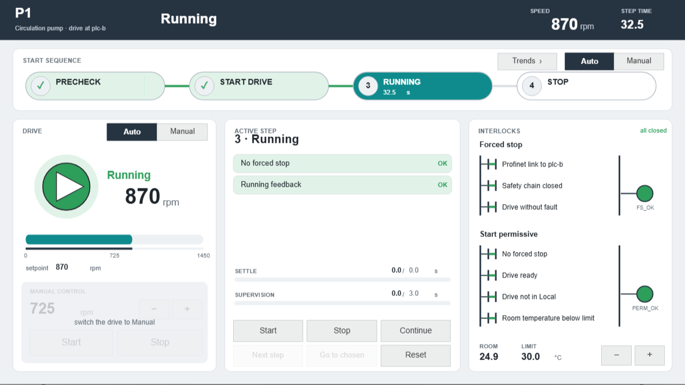
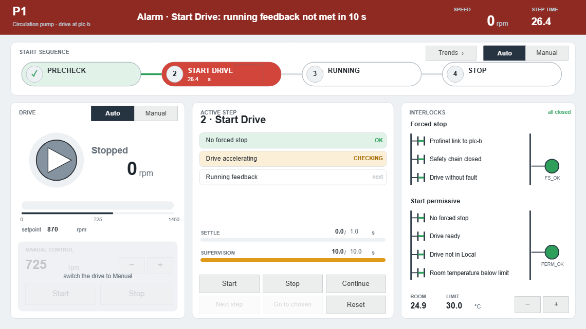
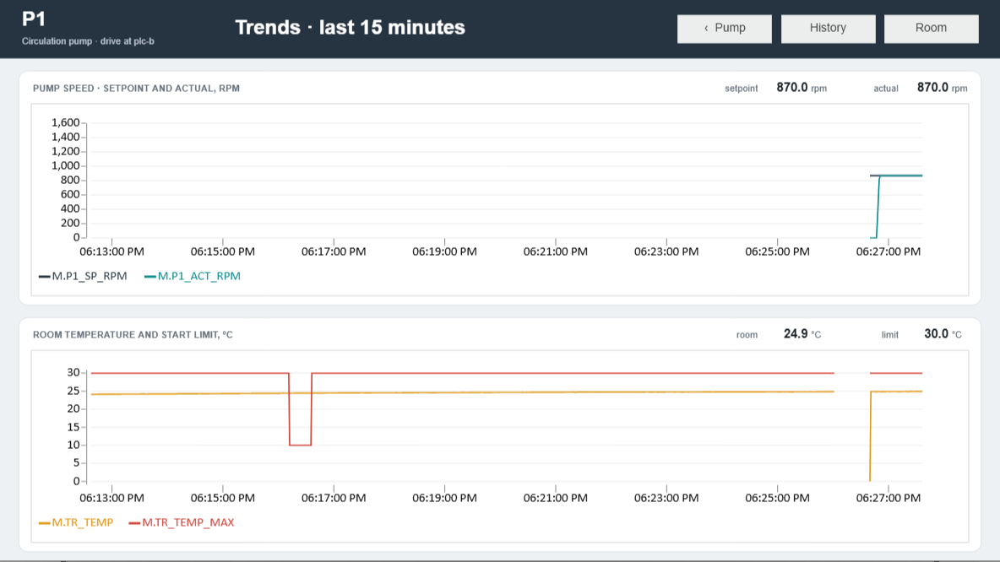
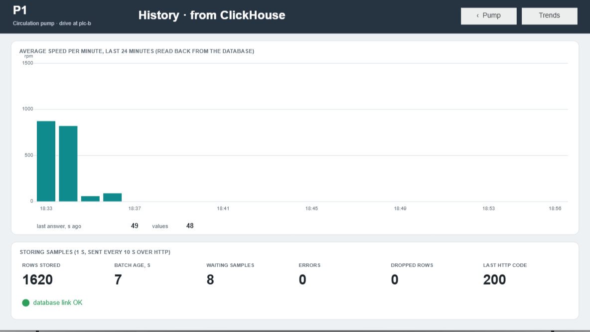
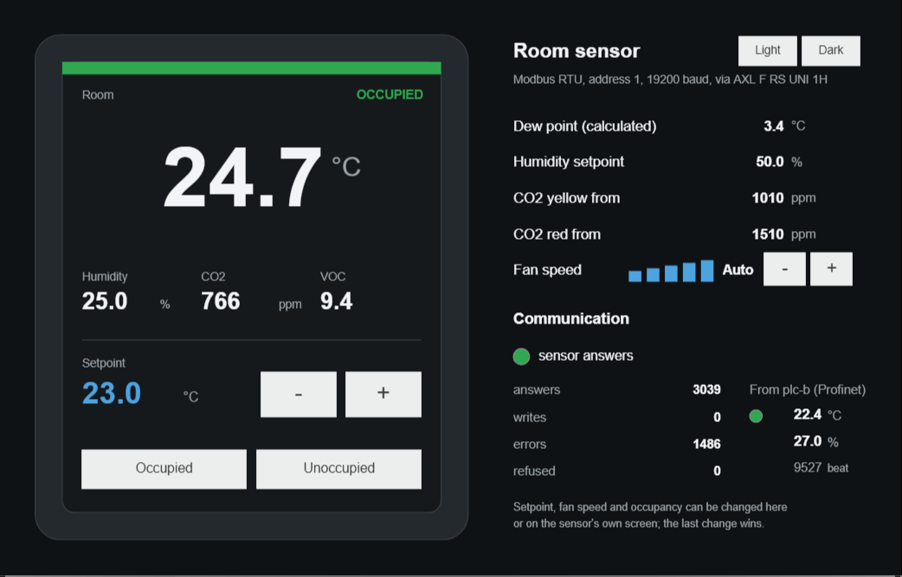

# pump-sequence: a pump start sequence in ST over Profinet, with interlocks, trends and a database

Two AXC F 2152. Controller A runs a pump start sequence; controller B, a Profinet device, simulates the pump's
drive and the safety chain, so every fault can be switched on from a script. A also reads the room sensor of
`../modbus-rtu-room-sensor` (its temperature is one of the start permissives), draws four pages, records two
trends on the controller, and stores ten values a second in a ClickHouse database.

**Proven** on 2026-11-24 on two AXC F 2152 (firmware 2026.0.2) with PLCnext Engineer 2026.6: both projects
written and running, `test_seq.sh` passed all 41 checks (below), the trends and the database link ran as described in
`../../reference/hmi-trends.md` and `../../reference/clickhouse.md`. What was not tried is at the end.





- `a/`: project PUMPSEQ on A (192.168.1.10). `MAIN` holds the room sensor's Modbus RTU code (from
  `../modbus-rtu-room-sensor`), the Profinet controller side (from `../profinet-pair`), the drive interface, the
  interlocks, the step sequence and the database link. `FB_CH` and `FB_TXT` are the ClickHouse client
  (`../clickhouse-log`), `FB_IEEE` / `FB_TOIEEE` the float conversion of the sensor. Pages in `hmi.py`: Pump,
  Trends, History, Room. `program.json` has the `io` links of the serial module and the Profinet ports, and the
  `datalogger` key with two sessions for the trends.
- `b/`: project DRVPN on B (192.168.1.11, station name `plc-b`). Program instance `M` (`MAIN`) is the Modbus TCP to
  Profinet bridge of `../profinet-pair`; instance `DRV` (`DRIVE`) is the drive and safety chain simulator.
  The page in `hmi.py` is the bridge's; the simulator is driven over REST.
- `test_seq.sh`: the tests, over REST.

The speed is shown in rpm: the drive takes per mille of its nominal speed, and nominal 1450 rpm = 1000 per mille
(`RPM_NOM`). The sequence runs the pump at `SPEED_SP` = 600 per mille (870 rpm).

## Before the first write

1. **Base project for A**: the serial module of `../modbus-rtu-room-sensor` **and** B as a Profinet device as in
   `../profinet-pair` (step 1 there), in one project, stripped to `AXCF2152-2026.0-RSUNI-PNB`. Without the room
   sensor, drop the Modbus RTU part of `MAIN` and `IL_TEMP` (the start then never passes requirement 5).
2. **B**: base `AXCF2152-2026.0-MBTCP` of `../profinet-pair`; put your Modbus TCP server into
   `b/program.json` (`modbus_tcp`; 192.168.1.50 is a placeholder). The drive simulator needs none of it.
3. **The database password** (A only): `a/src/MAIN/Code.st` has `KEY := '%%ENV:CLICKHOUSE_PASSWORD%%'`, so the
   build needs the environment variable `CLICKHOUSE_PASSWORD` (the password of the ClickHouse user `plc_writer`).
   Build it through your secret manager's runner, e.g. `op run -- scripts/pxe.sh build examples/pump-sequence/a`.
   Without a database, set any value and `CH_ON := FALSE` (or leave it on: the client counts errors and the plant
   does not care). The built `.plcnx2` then holds the password: do not share it (`../../reference/clickhouse.md`,
   "Security"). Change `HOST := '192.168.1.60'` to your server.
4. Write B, then A (`../profinet-pair`, steps 3 to 5), and name B on the network once by hand.

## Byte map (Profinet, 16 of 512 bytes each way, big endian)

Bytes 0 to 11 are those of `../profinet-pair`; the drive adds 4 and 6-7 to B, 12 and 14-15 from B. The same map
stands in a comment in `a/src/MAIN/Code.st` and in both programs of `b/`.

A -> B (A `PN_OUT`, B `PND_S1_INPUTS`):

| Bytes | Content |
|---|---|
| 0-1 | A's counter (INT) |
| 2-3 | A's room temperature x 10 (INT) |
| 4 | drive: bit 0 run, bit 1 reset |
| 6-7 | drive: speed setpoint, per mille 0..1000 (INT) |

B -> A (B `PND_S1_OUTPUTS`, A `PN_IN`):

| Bytes | Content |
|---|---|
| 0-1 | temperature x 10 of B's Modbus TCP server |
| 2-3 | humidity x 10 |
| 4-5 | battery mV |
| 6-7 | B's counter (INT) |
| 8 | status, bit 0: Modbus TCP server answers |
| 10-11 | A's counter, sent back (echo) |
| 12 | drive: bit 0 ready, bit 1 running (at speed), bit 2 fault, bit 3 safety chain closed, bit 4 local |
| 14-15 | drive: actual speed, per mille 0..1000 (INT) |

The simulator on B (`b/src/DRIVE`): the speed ramps toward the setpoint at 200 per mille a second while run is on
and the drive is ready, and back to 0 otherwise. "Running" is set at 90 % of the setpoint. Ready = no fault and
safety chain closed. A fault is latched until the reset bit (or the local reset). Without Profinet data B takes
no commands: run off, the drive stops unless it is in Local. Test switches, all `{ EHMI }` so REST can write
them: `DRV.SIM_TRIP` (drive fault), `DRV.SIM_ESTOP` (safety chain open), `DRV.SIM_NO_FB` (never "running"),
`DRV.SIM_LOCAL` (local switch; `LOCAL_RUN`, `LOCAL_SP`, `LOCAL_RESET` are its panel).

## The sequence

`SQ_STEP`: 0 idle, 1 PRECHECK, 2 START DRIVE, 3 RUNNING, 4 STOP, then back to 0. How it is built:
`../../reference/sequence-st.md`. In short:

| Step | Requirements, checked in this order | Settle | Supervision |
|---|---|---|---|
| 1 PRECHECK | Profinet link, safety chain closed, drive ready, drive not in Local, room temperature below the limit | 3 s | 15 s |
| 2 START DRIVE (run on) | no forced stop, speed above 0, running feedback | 1 s | 10 s |
| 3 RUNNING (run on) | no forced stop, running feedback | none: stays until Stop | 3 s, counted only while a requirement is lost |
| 4 STOP (run off) | running feedback off, speed 0 | 1 s | 15 s |

- **Requirements walked one by one.** A cursor (`RQ_AT`) moves down the step's list one row per 0.5 s while the
  rows are met, and falls back at once to a row that is lost. The page shows each row as OK, CHECKING or next.
- **Settle time.** When the cursor is through the list, the step's settle time runs (`SETTLE_T`); a row lost
  meanwhile starts it again. Then the next step.
- **Supervision time.** It runs from the step's start while a row is not met (`SUP_T` against `TMAX`). When it is
  up: alarm. `SQ_ALARM`, `AL_STEP` = the step, `AL_REQ` = the first row not met. The run command goes off, the step
  stays where it is (held), nothing moves on its own.
- **The alarm is held until Reset or Continue.** Reset (`SQ_CMD` 6): alarm off, back to idle, a 1 s reset pulse to
  the drive. Continue (3): alarm off, back to Auto, the supervision time starts again in the same step (a retry).
- **Forced stop**: in START DRIVE and RUNNING, a lost forced stop interlock (Profinet link, safety chain, drive
  fault) raises the alarm at once, in every mode: `AL_REQ` 11 Profinet, 12 safety chain, 13 drive fault.
- **Commands** come from the page as one INT, `SQ_CMD`, done and cleared in the same cycle: 1 Start (idle, no
  alarm, drive in Auto), 2 Stop (orderly: to STOP), 3 Continue, 4 Next, 5 Go to chosen (`SQ_SEL`), 6 Reset.
- **Manual (`SQ_MODE` 1)**: the sequence holds; nothing advances by itself, no supervision. Next forces the
  transition, Go to chosen jumps to `SQ_SEL`; both count in `OV_CNT` (last one in `OV_LAST`). They rank **below the
  forced stop**: a drive fault in a step reached by Go to raises the alarm and the run command goes off.
- **Drive mode** (`DRV_MODE`: 0 Auto, 1 Manual, 2 Local). Auto: run = step 2 or 3, no forced stop, no alarm. Manual:
  the page's Start / Stop and a speed in rpm (`MAN_RPM`, steps of 50), still cut off by the forced stop. Local: B's
  local switch has control, A sends no run. The switch Auto -> Manual takes over the running state and speed
  without a bump.

## Interlocks

Each condition is one BOOL in the program (`IL_...`, TRUE = fulfilled, contact closed); the page reads them as
they are.

| Group | Conditions | Result |
|---|---|---|
| Forced stop | `IL_PN` Profinet link (B's counter moved within 3 s), `IL_SIS` safety chain closed (and link up), `IL_DRVF` no drive fault | `FS_OK` |
| Start permissive | `FS_OK`, `IL_RDY` drive ready, `IL_REM` drive not in Local, `IL_TEMP` room sensor answers and temperature below `TEMP_MAX` | `PERM_OK` |

`IL_ACTIVE` counts the open ones. The limit is `TEMP_MAX10` (an INT, x 10, default 30.0 °C): the page steps it by
5 = 0.5 °C, because a page button cannot step a REAL by 0.5 (`../../reference/findings.md`, "HMI pages").

## Pages (`a/hmi.py`)

- **Pump** (start page): a banner with the state in words (ready, interlock open, starting, running, held,
  stopping, or the alarm text naming the step and the requirement), speed in rpm and step time. The steps as a
  flow of chips: done green, active teal, ahead white, red with the alarm; in Manual a Go button on each. The
  drive: mode switch Auto / Manual (amber "LOCAL" when B's switch has it), the pump symbol coloured by
  `DRV_STATE`, actual speed as a bar and the setpoint as a thin bar under it, the manual box (veiled unless
  Manual). The active step: its checklist, a settle bar and a supervision bar, the sequence buttons. The
  interlocks as a ladder: per group a rail, one contact per condition (closed: a green bar across; open: a red
  gap, the row red), the group's coil.
- **Trends**: speed setpoint and actual in rpm, room temperature and its limit, the last 15 minutes from the
  DataLogger sessions `Speed` and `Room` (ports `P1_SP_RPM`, `P1_ACT_RPM`, `TR_TEMP`, `TR_TEMP_MAX`).
- **History**: the average speed of each of the last 24 minutes, read back from ClickHouse every 60 s, as 24
  bars growing upward (`rect(..., grow=..., axis="y")`); the state of the database link (rows, batch age, waiting
  samples, errors, dropped rows, HTTP code, a lamp).
- **Room**: the room sensor's page of `../modbus-rtu-room-sensor`, with B's sensor values beside it.

How the pages are built (palette, cards, chips, checklist, ladder): `../../reference/hmi-design.md`.







## Test (`test_seq.sh`)

```bash
examples/pump-sequence/test_seq.sh                 # start estop nofb trip temp manual: 41 checks
examples/pump-sequence/test_seq.sh start trip      # some of them
A_HOST=... B_HOST=... examples/pump-sequence/test_seq.sh
```

Each test brings both sides to a clean state (B healthy, A idle in Auto, limit 30 °C, Reset), then works only
through `pxe.sh set` (writes variables over REST, as a page button does) and `pxe.sh wait` / `read`:

- `start`: Start, PRECHECK, the cursor through 5 rows, START DRIVE after the settle time, RUNNING, speed at 600 per
  mille, Stop, STOP, idle, no alarm.
- `estop`: safety chain opens while running: alarm at once, reason 12, run off, the drive stops at B; Reset.
- `nofb`: no running feedback: alarm in step 2 after its 10 s, requirement 3, run off and held; feedback back,
  Continue: the step is retried and RUNNING is reached.
- `trip`: drive fault while running: alarm, reason 13; the fault stays latched at B until Reset clears it.
- `temp`: limit below the room temperature: the interlock opens, the cursor stops at row 5, alarm after 15 s,
  requirement 5, the drive never commanded.
- `manual`: in Manual, Start holds in PRECHECK (8 s, no advance), Next to START DRIVE, Go to RUNNING, overrides
  counted, a drive fault still raises the alarm and cuts the run command.
- `pnloss` (not in the default set, **untested**): B's runtime restarted while running; expects alarm reason 11,
  run off, the link back within 120 s. Needs B's admin password (`PLC_B_SECRET` names its environment variable).

**Proven**: the default set, 41 of 41 checks passed. The pages were looked at on the controller while the
sequence ran (**seen**; no script checks a page).

## Not tried

- **Profinet lost during a run** (`pnloss`): what A sees and how fast, what B's drive does. B stops taking
  commands when `PND_S1_VALID_DATA_CYCLE` goes FALSE; that it does go FALSE on a lost link is untested
  (`../../reference/profinet.md`).
- **The room sensor coming back**: while the network was being changed it stopped answering once and came back
  by itself (**seen**, cause unclear). Pulling and reconnecting it on purpose: untested.
- **A power cycle** of either controller during a run, and whether B keeps its Profinet name through one.
- Drive Manual and Local (`DRV_MODE_REQ`, `DRV.SIM_LOCAL`) are not in the test script: untested.
- The page's veils (half transparent rectangles over the Go and manual buttons): whether they stop a click is
  untested. The program ignores those commands outside Manual anyway.
