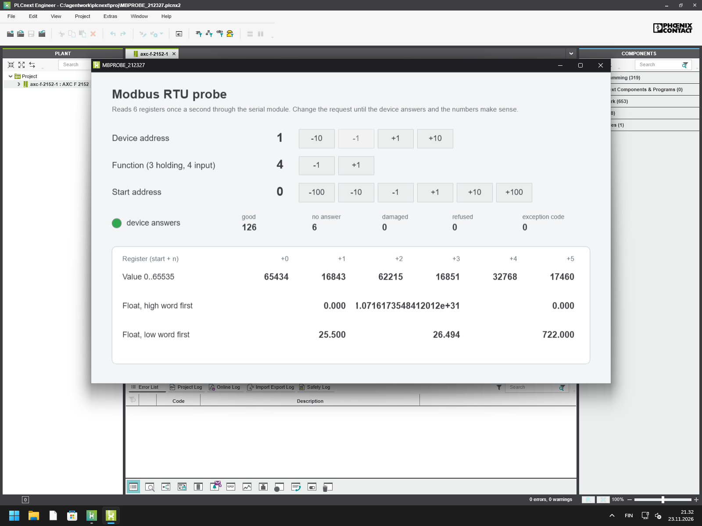

# rs-uni-modbus: a Modbus RTU probe

For bringing a Modbus RTU device to life on an AXC F 2152 with an AXL F RS UNI 1H: the controller reads six
registers a second and serves a page where device address, function (3 holding, 4 input) and start address are
chosen with buttons. It shows the registers raw and each pair as a float in both word orders, and counts good
answers, missing answers, damaged ones and refusals with the exception code. Proven on the controller.

How to use it and what the counters mean: `../../reference/modbus-rtu.md`. `program.json` names the base project
(one that holds the serial module, set to Modbus/RTU and the line's baud rate and parity) and links the program's
ports to the module's process data.

A complete device on top of the same exchange, with writes: `../modbus-rtu-room-sensor`.
