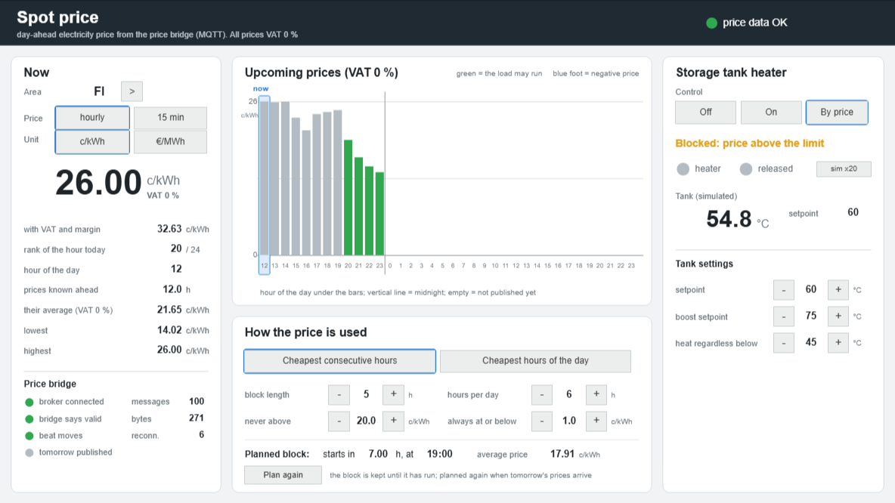

# spot-price: electricity spot price in a controller program

AXC F 2152 (firmware 2026.0) gets day-ahead electricity prices from a small bridge on another machine over MQTT,
runs one load by them (a simulated storage tank heater) and shows them on a page: the price now, the upcoming
prices as bars, the plan and its settings. On the page the operator chooses the **area** (15 Nordic and Baltic
bidding areas), **hourly or 15 minute prices**, and the unit **c/kWh or €/MWh**. Proven on a controller with fixed
test prices and with live prices.



All prices are **VAT 0 %** (the market price); the bridge can add VAT and a margin per area for the one value
"with VAT and margin".

## How the price gets in

The controller does not reach the internet. `bridge/spotd.py` runs on a machine that does: it fetches the prices
and publishes plain numbers to an MQTT broker (retained, every 10 s). The controller subscribes: it opens the
connection itself, nothing is opened towards it. Bridge: `bridge/README.md`; every topic and register:
`bridge/CONTRACT.md`.

```
price source  <--HTTPS--  bridge  --MQTT-->  broker  <--MQTT--  controller
 (internet)              (IT side)                              (OT side)
```

- The program subscribes to `spot/<AREA>/flat60` (hourly) or `spot/<AREA>/flat15` (15 minute): one flat JSON
  object, `p0` = the running slot, `p1`.. the upcoming ones (up to 48 hours or 96 quarters), about 0.5 to 1.5 kB.
  Changing area or resolution on the page subscribes again to the other topic; data and plan start afresh.
- Receiving is done in the program with `FB_MQTT_SUB` and `FB_JSON_NUM` from `../mqtt-subscribe` (plain TCP, no
  login, QoS 0: for a broker inside the plant network; no TLS). A message is read over several cycles, 6 numbers
  per cycle, from a copy, and taken over in one step when complete.
- **Price usable** = broker connected, a complete message read, the bridge says valid, its beat moved within the
  last 60 s. Otherwise the price control is off, the heater runs on its thermostat alone, alarm after 10 s.
- The bridge must serve the chosen area (its config list); an area it does not serve gives "no price data".

## How the price is used

- **Cheapest consecutive hours** (setting, 1..12 h, default 5): the cheapest block among the known upcoming
  slots; with 15 minute prices it can start at any quarter. The block is **frozen once chosen**: a search
  repeated over a moving window can push the start ahead for ever. Planned again when the block has run, when
  its length is changed, when more slots became known before it started (tomorrow's prices arrive in the
  afternoon), when the clock jumps, and on the button. A block that already runs is kept even if tomorrow's
  prices would give a cheaper one.
- **Cheapest hours of the day** (the other setting): rank of the running hour (from the bridge, hourly, per
  calendar day) <= N.
- In both: never above a price limit (a slot above it is blocked even inside the block); always at or below a
  low limit, then with the boost setpoint (negative prices). Tank below its minimum: heats whatever the price.
- The limits are checked against the price of the chosen resolution. Inside, everything is c/kWh; the unit
  toggle changes only what the page shows (1 c/kWh = 10 €/MWh).

## Files

| File | |
|---|---|
| `gen.py` | writes `program.json`, `areas.json` and `src/MAIN`. Broker address and port, the controller's address and the area list are at its top |
| `src/FB_MQTT_SUB`, `src/FB_JSON_NUM` | from `../mqtt-subscribe`, unchanged |
| `hmi.py` | the page; two sets of bars (36 hours, or 96 quarters = 24 h), each `rect(..., grow=(variable, 0, 100), axis="y")` |
| `bridge/` | the bridge, the list of what it serves, a config example |
| `modbus/` | the same idea over the firmware's Modbus TCP client: no program code for the protocol, but hourly prices only, 24 hours, area fixed in the project (32 registers per server) |

```bash
python3 examples/spot-price/gen.py
scripts/pxe.sh build examples/spot-price && scripts/pxe.sh open examples/spot-price/SPOT.plcnx2 && scripts/pxe.sh write
```

## Tests on the controller, prices from the bridge's fake source, Mosquitto as broker

| Test | Result |
|---|---|
| Hourly, 13:30, tomorrow known | 35 hours known, block of 5 h planned at 02:00 (average 4.00 c/kWh), waiting; `shot-hourly.png` |
| Hour 13 -> 14 | plan kept, starts in 12 h |
| Tomorrow missing (11 hours known) | block among today's hours, starts at once |
| Clock inside the block | released, cheap hour; `shot-block.png` |
| Negative price (-1.5) | released, boost setpoint; `shot-negative.png` |
| 25 c/kWh, limit 20 | blocked |
| 15 minute prices, €/MWh | 96 quarters known, quarter price shown, block start 12.5 h ahead; `shot-15min-mwh.png` |
| Quarter 54 -> 55 | plan kept, starts in 12.25 h |
| Area changed on the page | served area: its prices after the next message; area the bridge does not serve: no price data, alarm |
| Buttons on the page | area, resolution and unit change the variables |
| Source dead (valid 0) | normal operation, alarm; price control again when it returns |
| Bridge stopped, broker up | beat watchdog after 60 s: normal operation, alarm; recovers |
| Broker stopped | connection lost: normal operation, alarm; reconnects by itself when it is back |

Not tested: a whole day in real time (the tests moved the bridge's clock), the change of the clocks in spring
and autumn, a broker with login or TLS (the block has neither).

## Found on the way

- An initial value goes before the flags: `X : REAL := 1.0 { EHMI };` (the other order: "';' expected").
- One variable per line in `Variables.var`: a second declaration on the same line is dropped without a message.
- A button's step for a REAL variable must be a whole number: 0.5 is refused when the page is built.
- `CONCAT` and `MID` work on STRING as in the standard (`MID(S, length, position)`); a key like `p37` is put
  together with them.
- Writing a BOOL through the REST interface takes `true` / `false` in small letters (`TRUE`: TypeMismatch).
