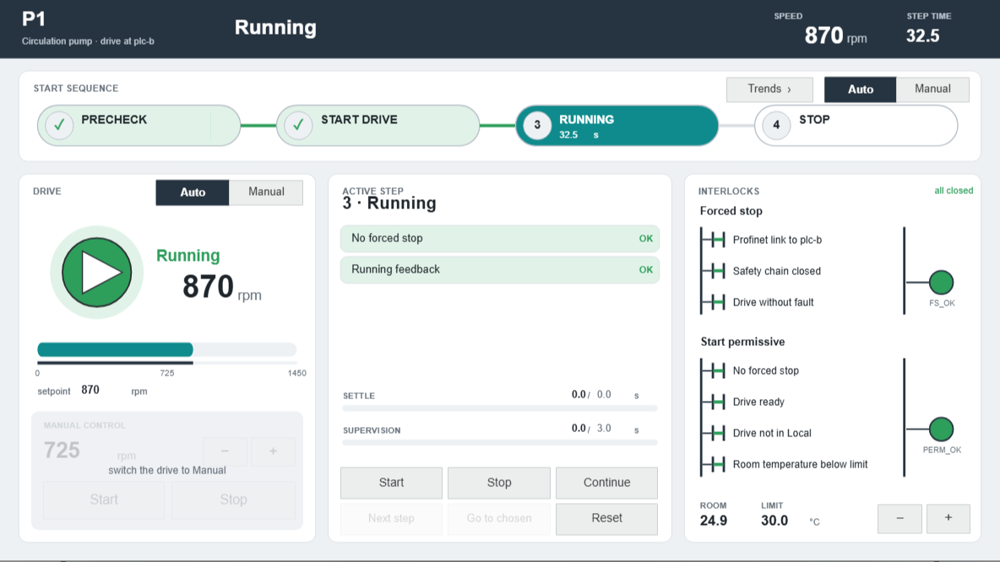
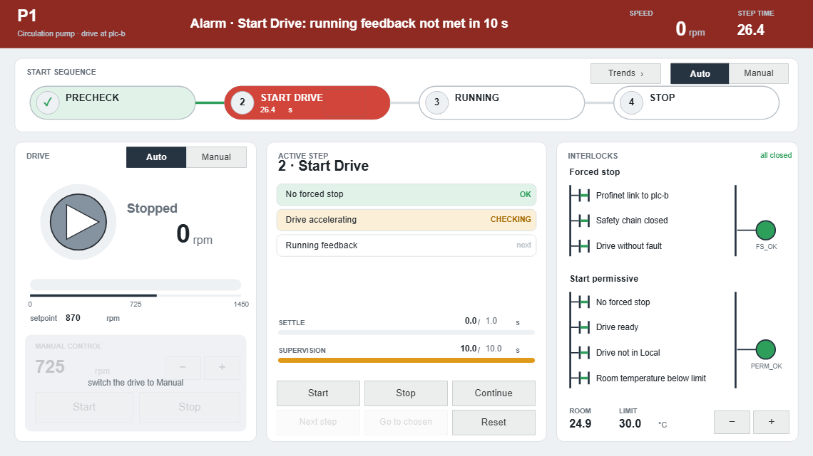
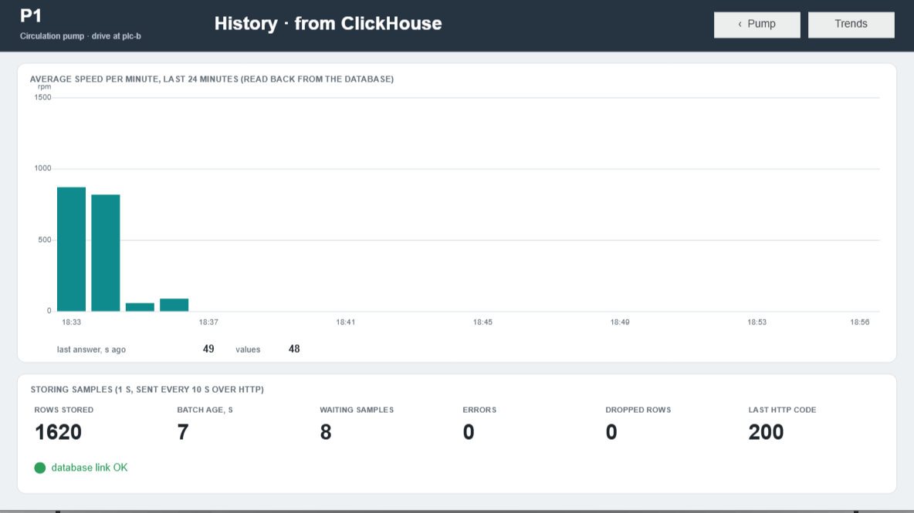

# Operator pages that look good, with pxhmi

How the pages of `examples/pump-sequence` are built (`a/hmi.py`, functions `pump()` and `history()`). Seen on the
controller's page server on 2026-11-24 (AXC F 2152, firmware 2026.0.2, Engineer 2026.6); the pictures are in
`examples/pump-sequence/img/`. The look is our own, made for this skill; it copies no vendor's faceplates or
symbol library. `pxhmi.py` has only rectangles, ellipses, lines, texts, values, buttons and charts: everything
below is made of those.



## Palette as tokens

Name every colour once at the top and use only the names. A light page, white cards, one dark slate for
headers and active switches, one accent (teal) for "active" and its light tint, and a strong and a light shade
for each state colour:

```python
PAGE, CARD, LINE, INK, DIM, FAINT = "#FFEEF1F4", "#FFFFFFFF", "#FFD9DEE3", "#FF1E252B", "#FF66707A", "#FFB7BFC7"
SLATE, TEAL, TEAL_L, OK, OK_L, AMBER, AMBER_L, RED, RED_L = ("#FF263340", "#FF0F8B8D", "#FFD7EFEF", "#FF2E9E5B",
    "#FFE1F3E8", "#FFE09A1A", "#FFFBEFD8", "#FFD2453B", "#FFFBE3E1")
```

The strong shade colours a symbol or a text; the light one fills the area behind it (a row, a halo). Keep red for
faults and alarms only, so it means something when it shows.

## Cards

A white rounded rect with a thin line, and its title in small capitals: size 12, bold, the dim colour. The title
names the area; the content carries the weight.

```python
def card(p, oid, x, y, w, h, title):
    p.rect(oid, x, y, w, h, fill=CARD, line=LINE, radius=12)
    p.text(oid + "T", x + 18, y + 12, w - 36, 22, title.upper(), size=12, weight=700, color=DIM)
```

## Status banner

A full-width band at the top: tag and description on the left, the state in words in the middle, the main value
and the step time on the right. The band's colour follows the state, `fill_by=("M.SQ_STATE", [(0, SLATE), (1,
SLATE), (2, dark amber), (3, dark red), (4, SLATE)])`. The state text is one text object per state, each
`visible` by an expression; the alarm text is one object per step and requirement ("Alarm · Start Drive: running
feedback not met in 10 s"), `visible` by `AL_STEP` and `AL_REQ`. A page cannot pick a string from a table, so a
generator loop writes all of them; the program only gives the numbers.



## Step flow as chips

One rounded chip per step (`radius` = half the height), joined by short links. Done, active and ahead come from
one expression per chip and the thresholds of `fill_by`:

```python
rel = "M.SQ_STEP - %d" % n                       # < 0 ahead, 0 active, > 0 done
p.rect("Chip%d" % n, cx, 136, 260, 52, fill=CARD, line=FAINT, line_width=1.5, radius=26,
       fill_by=(rel, [(-9, CARD), (0, TEAL), (1, OK_L)]))
p.rect("ChipA%d" % n, cx, 136, 260, 52, fill=RED, line=RED, radius=26, visible="M.SQ_ALARM AND M.SQ_STEP = %d" % n)
```

The link before chip n uses `M.SQ_STEP - (n - 1)` the same way (grey, then green once passed). A number in a
circle, replaced by a tick once the step is done; the step name twice (dark ink, and white while active); the
step time under the name of the active chip only.

## Checklist with settle and supervision bars

Up to five rows under the active step's name. Row i's fill follows the cursor of the sequence:
`fill_by=("M.RQ_AT - %d" % i, [(-9, CARD), (0, AMBER_L), (1, OK_L)])`: white "next", amber "CHECKING", green
"OK", with the word at the right end of the row, each `visible` by `RQ_AT`. The row's text is one object per step,
`visible` in its step. Under the rows two thin bars that `grow` with `SETTLE_PCT` and `SUP_PCT` (0..100, computed in
the program), each with "now / of s" above its right end. Settle in the accent colour, supervision in amber: the
amber bar filling up is the alarm coming.

## Segmented mode switch

Auto | Manual as two buttons side by side that write 0 and 1. Over the active one a dark rect and a white text,
`visible` while the variable has that value:

```python
for i, name in enumerate(["Auto", "Manual"]):
    bx = x + i * bw
    p.button("%s_b%d" % (oid, i), bx, y, bw, 32, name, write=(var, str(i)), size=14)
    on = "%s = %d" % (var, i)
    p.rect("%s_a%d" % (oid, i), bx, y, bw, 32, fill=SLATE, line=SLATE, visible=on)
    p.text("%s_t%d" % (oid, i), bx, y + 7, bw, 20, name, size=14, weight=700, color=WHITE, align="Center", visible=on)
```

A third state the operator cannot choose (Local, from the drive) covers the whole switch in amber with its own
text.

## Veils over controls that do not apply

A button cannot be disabled. Cover it with a half transparent rect of the background colour (`#C8EEF1F4`,
alpha C8), `line_width=0`, `visible` while it does not apply, and put a short reason on it ("switch the drive to
Manual"). The controls show greyed out. Whether the veil stops a click is untested: the program must ignore the
command in that state anyway.

## Interlock ladder

One block per group: a title, a vertical rail on the left, one row per condition, a vertical bar on the right and
the group's result as a coil.

- The row: a rect behind the text, `fill_by=(cond, [(0, RED_L), (1, CARD)])`, light red while the condition is
  open.
- The contact: two short vertical rects (the plates) and a short horizontal rect from the rail to the first.
  Closed: a green bar across the plates, `visible=cond`. Open: a red outline in the gap, `visible="NOT " + cond`.
- The coil: an ellipse on a short wire after the right bar, `fill_by=(group, [(0, RED), (1, OK)])`, the group's
  variable name under it.
- At the card's top right: "all closed" in green, or the number of open interlocks in red.

Every condition and every group result is its own BOOL in the program; the page computes nothing.

## Pump symbol with a halo

`pump(id, cx, cy, state, r=44, colors=[(0, grey), (1, OK), (2, RED), (3, AMBER)])`, and behind it a larger
ellipse in the light shade of the same state (`fill_by` on the same variable, no line): the halo makes the state
readable from across the room. Beside it the state in words and the speed large.

## Speed bar and setpoint bar

A thick rounded bar for the actual value (`rect(..., grow=("M.SPEED_ACT", 0, 1000))` over a background rect of the
same size) and a thin dark bar of the setpoint right under it, the same width and scale. The gap between them is
the deviation, seen without reading a number. Scale texts under it (0, half, full, in the display unit).

## Vertical bars

`rect(..., grow=(var, low, high), axis="y")` grows upward from the bottom edge: pxhmi puts the scaling pivot at
the bottom left (`pivot=(0, h)`), otherwise the bar would grow downward from its top. The History page draws 24
of them from one loop, with grid lines as 1 px rects, axis texts, and the minute under every fourth bar.



## Navigation

`button(..., page="Trends")` switches pages (`hmi-trends.md`). Put the buttons in the same place on every page
(the banner's right end), and give each page the same banner so they read as one set.

## Lessons

- A button's `step` must be whole: 0.5 on a REAL is refused ("Invalid step value"). Keep the value as an INT x 10
  in the program, step it by 5, and let the program make the REAL.
- Keep conversions out of page expressions (`TO_REAL(...)` and the like): compute percentages, rpm from per
  mille, a REAL from its x 10 INT in the program and show the result. The page then holds only variable names and
  comparisons, which compile without surprises.
- A rect that covers a button must have `line_width=0`, or its outline shows around the button.
- One declaration per line in `Variables.var`: `pxproj.py` reads only the first of a line, so a second variable
  on the same line is not seen by the page (`findings.md`).
- `pxe.sh tap` maps page coordinates to the screen with the size of the start page of the **last project built**
  (`~/.plcnext-engineer/page-size`, written by every build that has an `hmi.py`). An offline build of another
  project changes where taps land on the page that is open: build the project you tap on last, or write its size
  back into that file.
- Text does not wrap and is clipped at its box: make boxes generous, and check the page picture
  (`pxe.sh hmi out.png`) after each change.
